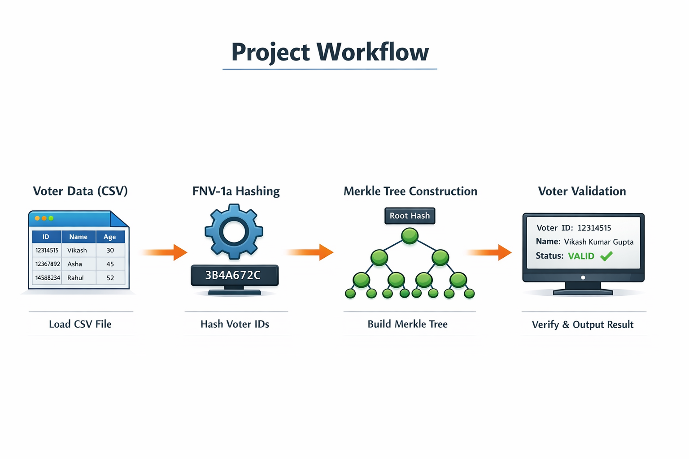

 
# 🚀 Secure E-Voting Validation System Using Merkle Tree

[](https://isocpp.org/) [](LICENSE) [](https://github.com/KrVikashGupta) [](https://github.com/KrVikashGupta) [](https://github.com/KrVikashGupta/issues)

A **Secure E-Voting Validation System Using Merkle Tree** in **C++** using **FNV-1a hashing** and **Merkle Trees**, ensuring **secure voter verification** and **data integrity**.

---
    
## ✨ Features

* 🔐 **Secure Voter Verification**
* 🌳 **Tamper Detection** with **Merkle Trees**
* ⚡ **Efficient Hashing** using **FNV-1a**
* 📄 CSV-based voter data input
* 🖼️ Merkle Tree Visualization
* 🧩 Modular and maintainable C++ code

---

## 🛠️ Tech Stack

* **C++** – Core language
* **FNV-1a Hash** – Fast, consistent hashing
* **Merkle Tree** – Data integrity verification
* **CSV Parsing & File I/O** – Load voter datasets
* **STL (Vectors, Smart Pointers)** – Efficient memory handling

---

## ⚙️ How It Works

### Project Workflow



**Steps:**

1. Load voter IDs from a **CSV file**
2. Hash each ID using **FNV-1a**
3. Build a **Merkle Tree** from hashes
4. User enters voter ID for validation
5. System checks ID in Merkle Tree
6. Output: `VALID` / `INVALID` + voter info

---

## 🖥️ Sample Output

```
=======================================
|--- Secure E-Voting Validation System ---|
Enter Voter ID: 12314515
Verification process initiated...
Name: Vikash Kumar Gupta
Status: VALID
=======================================
```

---

## ⚡ Challenges

* Handling **large datasets (~7000+ voters)**
* Ensuring consistent **hash generation**
* Dealing with **invalid/missing CSV data**
* Optimizing **Merkle Tree construction & search**

---

## 📚 Learnings

* Implemented **Merkle Trees** from scratch
* Learned **cryptographic hashing & data integrity**
* Mastered **CSV parsing & file handling in C++**
* Built **clean, modular, maintainable code**

---

## 🚀 Future Enhancements

* Dynamic Merkle Tree for **large CSV datasets**
* **Blockchain integration** for immutable records
* Add a **Graphical User Interface (GUI)**
* Support **multi-user concurrent validations**
* Implement **fast search** using hash maps

---

## 🤝 Contributing

Contributions welcome!

* Fork & clone the repo
* Open issues / submit pull requests
* Optimize code or add features

---

## 📫 Contact

**Vikash Kumar Gupta**  
📍 Bokaro Steel City, Jharkhand  
✉️ [vikashkumargupta907@gmail.com](mailto:vikashkumargupta907@gmail.com)  
🔗 [LinkedIn](https://linkedin.com/in/vikash1995) | [GitHub](https://github.com/KrVikashGupta)

---

⭐ If you find this project useful, please consider giving it a star to support the work!
